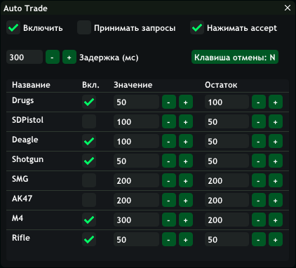

# Скрипт для автоматического трейда (Samp-Rp)

Этот скрипт автоматизирует обмен предметами на проекте Samp-Rp: выбирает настроенные предметы и количества, обрабатывает инвентарь с несколькими страницами и при необходимости автоматически подтверждает обмен.

## 📥 [**Скачать script.zip**](https://github.com/melvin-costra/auto-trade/releases/latest/download/script.zip)

> После скачивания перенеси файлы из архива в папку `moonloader`.

  

---

## 🔧 Функции

- **Включить** — запускает автоматическую передачу отмеченных предметов после открытия окна обмена.
- **Принимать запросы** — отправляет `/accept invtrade`, когда в чате появляется приглашение на обмен.
- **Нажимать accept** — автоматически нажимает кнопку `accept` после добавления предметов в исходящем обмене или после сообщения о согласии второй стороны во входящем обмене. При включённой настройке подтверждение применяется также к подходящему диалогу обмена.
- **Запрос трейда** — удерживайте правую кнопку мыши и нажмите `Q`, чтобы отправить `/itrade` игроку, на которого направлен прицел.
- **Задержка (мс)** — пауза между автоматическими кликами; настраивается в диапазоне 200–2000 мс.
- **Клавиша отмены** — выбирается в окне настроек. Нажатие прерывает активную автоматизацию, если чат и диалог игры не открыты. По умолчанию `N`.
- **Список предметов** — для каждого предмета можно включить передачу, задать количество и минимальный остаток в инвентаре. Если запрошенное количество оставит меньше заданного остатка, скрипт уменьшит передачу до допустимого остатка; если остаток уже достигнут, предмет пропускается.
- **Страницы инвентаря** — если на текущей странице нет пустого слота и нужные предметы ещё не найдены, скрипт может перейти на следующую страницу (не более одного раза за обмен).

### Общее
- **Клавиша отмены** — настраиваемая клавиша (по умолчанию `N`) для остановки трейда
- **Задержка** — настраиваемая задержка автоматических кликов по предметам для трейда (в миллисекундах)

---

## ▶ Команды

- `/atrade` - открыть/закрыть окно настроек скрипта

## 📢 Связь

Подпишись на мой телеграмм канал и будь в курсе обновлений - [@melvin_costra](https://t.me/melvin_costra)

Мой телеграм - [@vovka8101](https://t.me/vovka8101)

